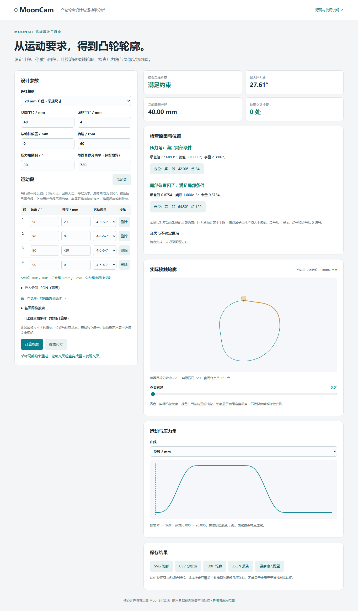

# MoonCam

**用 MoonBit 将运动要求转换为凸轮轮廓，并计算运动学与几何约束。**

面向机械课程设计、低速教学模型和凸轮方案初选。输入分段升程、机构尺寸和转速，由 MoonBit 输出真实滚轮接触轮廓与采样约束分析。

| 速览 | 当前交付 |
| --- | --- |
| 模型 | 平面盘形凸轮、直动滚子从动件、正负偏置、恒定正转速 |
| 核心语言 | MoonBit：运动学、几何、采样、搜索、判定、校验与导出 |
| 输入 → 输出 | JSON / MoonBit 类型 → 分析报告、点数据、CSV、SVG、毫米制 DXF |
| 通过的含义 | 局部采样约束满足，且采样折线检查完成、确定零交叉 |
| 不确定时 | 单独报告；不解释成通过，也不宣称物理不可行 |
| 搜索范围 | 有限网格首个通过复核的基圆候选，不是连续全局最优 |

[第一次使用：完整操作案例](docs/完整操作案例.md) · [公共 API](docs/公共API.md) · [输入输出](docs/输入输出说明.md) · [状态、上限与错误码](docs/接口契约.md) · [设计取舍](docs/设计取舍.md) · [固定验收用例](docs/判定验收.md)

运行时无需 Python、CAD 或远程服务；JavaScript 只承担 Node.js / 浏览器宿主对接。核心库可在 MoonBit 中直接使用。



## 快速运行

安装 [MoonBit 工具链](https://www.moonbitlang.com/download/)，确保 `moon` 在 PATH 中。可复现工具链为 `0.10.15+943464bfa`，CI 使用同一固定版本。

```sh
git clone https://github.com/huahai29/mooncam.git
cd mooncam
moon test --target wasm-gc
moon run examples/library --target wasm-gc
```

以上只需要 MoonBit，不需要 Node.js。`examples/library` 直接调用类型化库，输出默认案例的最大压力角、最小局部偏置因子和点数。

使用 CLI 和网页时，再安装 Node.js 22 或更新版本：

```sh
npm run build
node bin/mooncam.mjs examples/workshop.json --out artifacts/workshop
npm run serve
```

访问 `http://127.0.0.1:4173/`。网页用表格编辑运动段，每段独立选择规律，MoonBit 实时校验总转角、回零与累计升程；高级入口支持分段 JSON 导入。第一次使用可打开工作台中的完整案例教程。运行上述流程无需安装 npm 开发依赖。输出目录包含 `profile.svg`、`profile.csv`、`profile.dxf`、`report.json`、`input.json`。

CLI 退出码：`0` 表示局部条件通过且折线交叉检查完成、未发现交叉；`2` 表示采样检查拒绝；`3` 表示搜索未找到候选；`4` 表示检查未完成；`1` 表示输入或运行错误。通过采样检查不等于连续轮廓全局无干涉或制造认证。

## 五个可运行案例

| 输入文件 | 用途 | 预期结果 |
| --- | --- | --- |
| `examples/workshop.json` | 20 mm 升程、40 mm 基圆、4 mm 滚轮 | 最大压力角约 27.61°，满足所设 30°限制 |
| `examples/pressure-limit.json` | 将基圆缩小到 5 mm | 局部约束不满足，CLI 返回 2 |
| `examples/crossing-profile.json` | 1 mm 基圆、20 mm 滚轮、72 分辨率的诊断反例 | 采样轮廓有 2 组确定交叉边对，CLI 返回 2 |
| `examples/offset-follower.json` | 从动件偏置 10 mm | 正负压力角及轮廓随偏置变化 |
| `examples/size-search.json` | 在 5～100 mm 内按 1 mm 步长搜索 | 得到 36 mm 候选，复核压力角约 29.52° |

```sh
node bin/mooncam.mjs examples/size-search.json --out artifacts/search
```

36 mm 是有限网格与采样条件下的结果，不代表连续参数空间中的最小可行尺寸。

## 看懂检查结果

网页在“检查原因与位置”中显示压力角与偏置因子的余量，点击定位可同步选中运动段、采样接触点和曲线转角。发生交叉或几何不确定时，可选择相关边对，查看两条边的角度范围。程序段在网页从 1 展示，JSON 段下标、点号与边号从 0 编号。

勾选“比较三档采样”可对同一机构尺寸比较指标、最差位置和检查状态；默认不开启。JSON 对应 `compare_sampling: true`，结果保存在 `sampling_comparison`。每档独立编号，比较表的点号不能直接用于当前轮廓；状态相同和数值稳定都不构成连续证明。

操作步骤、字段含义与验收见[位置、诊断与采样比较](docs/位置诊断与采样比较.md)。

## 在 MoonBit 中调用

完整签名与错误约定见 [公共 API](docs/公共API.md)。根目录是可复用库，`examples/library/` 是完整调用示例。目前尚未发布到 Mooncakes，不能直接使用 `moon add huahai29/mooncam`；可以克隆运行或作为本地模块依赖使用。

```moonbit
let p = @cam.example_program(@cam.Polynomial4567)
let g : @cam.Geometry = {
  base_radius: 40.0,
  roller_radius: 4.0,
  offset: 0.0,
}
match @cam.analyze(p, g, 720, @math.PI / 6.0, 2.0 * @math.PI) {
  Ok(a) => println(a.max_pressure * 180.0 / @math.PI)
  Err(message) => println(message)
}
```

核心 API 使用弧度、rad/s 和统一长度单位。JSON、CLI、网页固定使用毫米、角度、rpm。CSV 明确保留对角度的导数；JSON 使用时间导数。详见 [输入输出说明](docs/输入输出说明.md)。

## 实现与验证

运动学、接触几何、采样、搜索、交叉判定、输入校验与导出均由 MoonBit 实现。JavaScript 负责浏览器和 Node.js 宿主对接，Python 仅用于独立开发验证。

- [架构说明](docs/架构说明.md)：模块职责、数据流、状态与资源边界。
- [验证记录](docs/验证记录.md)：测试方法和独立数值验证。
- [设计取舍](docs/设计取舍.md)：采样、搜索、容差、输出和兼容策略。
- [判定验收](docs/判定验收.md)：固定几何案例、预期状态和验收命令。

GitHub Actions 检查格式、公共接口快照、四个后端测试、接口/CLI、独立数值、DXF 和桌面/手机浏览器，并保存性能观测。实际运行状态以仓库 Actions 页面为准。

## 适用边界

`sampled_local_feasible` 只表示局部条件；`sampled_feasible` 还要求折线交叉检查完成且计数为零。`crossing_check` 明确区分完成、不确定、失败和未检查。折线判定不代表连续轮廓没有采样间回环或非局部滚轮干涉。应提高分辨率检查收敛；采样不能替代连续极值求解。

当前不包含强度、载荷、弹簧预紧、磨损、弹性和公差分析。DXF 是离散轮廓交换文件，未承诺可直接加工。详见 [算法与适用范围](docs/算法与适用范围.md)。

## 来源和后续工作

按公开机械运动学公式独立编写，未复制第三方凸轮实现代码。参考项目与来源见 [参考与来源](THIRD_PARTY_NOTICES.md)，采用 [MIT 许可证](LICENSE)。已有数学方法不作为原创理论申报；项目贡献是 MoonBit 实现、组合接口、验证和工作流。

[后续改进清单](docs/后续改进清单.md) 记录仍需扩展的能力。

## 0.2 版本接口变化

当前包版本为 0.2.0，JSON schema 为 2。默认只返回点数据和摘要；通过 `outputs` 选择 points / csv / svg / dxf，空数组仅返回摘要，`include_input` 控制输入回显。CLI 自动按需请求格式，报告只保存摘要与文件引用。响应中的名义分辨率改为 `sampling.nominal_resolution`（请求仍使用 `resolution`），实际点数另行报告；根切角字段改名为 `min_offset_factor_angle`。旧版本调用方需按 [输入输出说明](docs/输入输出说明.md) 迁移。

历史优化核查见 [优化核查记录](docs/优化核查记录.md)；当前接口与状态以 [接口契约](docs/接口契约.md) 为准。
