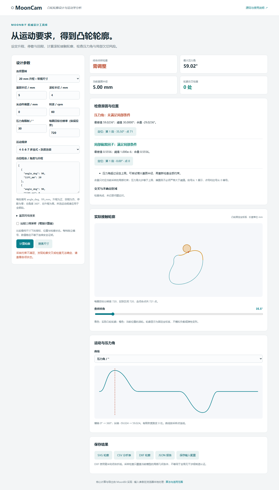
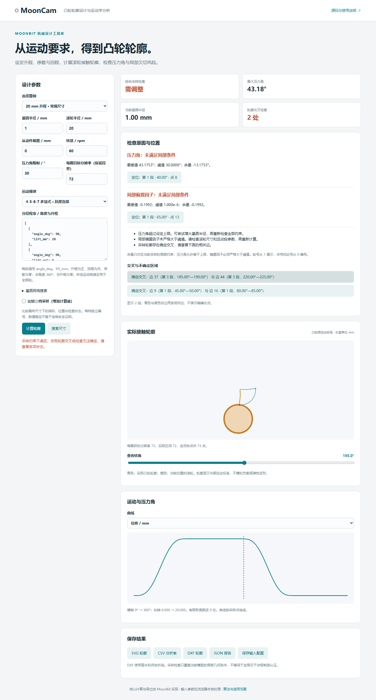

# 位置、诊断与采样比较

这组功能用于解释已有采样检查结果。运动学、位置查询、余量、比较与边对证据都由 MoonBit 提供；网页负责显示和选择。

## 一套位置编号

- `segment_index`：程序段的零基下标；网页“第 1 段”对应下标 0。
- `sample_index`：本次采样数组下标。每个点都带有段下标和 `theta_rad`。
- `edge_index`：边 i 连接点 i 与 i+1。含重复闭合点的 N+1 个点对应 N 条边。

段区间左闭右开，边界点归下一段；`theta=2π` 的闭合点保留末尾下标，周期运动值与所属段归首段，并带 `periodic_endpoint=true`。最后一条边起于末段、止于闭合点，边归末段。边终点所属段可能不同于边本身。

`locate_angle` 只查询 [0,2π] 中角度的段位置，不返回最近采样点；`sample_index=null`。`locate_sample` 查询已有点，`locate_edge` 查询已有边。内部共享 `segment_at`，运动求值也使用同一段界规则。

编号只在同一次采样中有效。不同分辨率的“点 84”不是同一个身份；比较时应结合段号与角度。

## 看懂一次失败

1. 选择“小基圆 · 压力角不满足”，点击“计算轮廓”。
2. 压力角约 59.02°，上限 30°，余量约 -29.02°，原因是压力角超限。
3. 点击压力角的“定位”，当前 720 分辨率对应第 1 段、35.5°、点 71。轮廓高亮该段，接触点与曲线游标指向同一个点 71。
4. 尝试更大基圆后重新计算全部约束；提示是调整方向，不保证修改单个参数就一定通过。

压力角余量为上限减实际最大值，允许等于上限；偏置因子余量为实际最小值减阈值，必须严格大于阈值。后者无量纲，仅说明局部法向偏置条件，不表示强度、寿命或制造余量。等高极值取首次采样位置，不声称唯一。



## 比较三档采样

网页勾选“比较三档采样”，或在原 JSON 请求增加：

```json
{"compare_sampling": true}
```

这是需要合并到完整输入中的字段，不是独立请求。默认 false。以最终报告名义分辨率 r 为基础，若 4r 不超过 JSON 上限则用 [r,2r,4r]，否则用 [floor(r/4),floor(r/2),r]。例如 720 对应 720、1440、2880；4000 对应 1000、2000、4000。搜索只在找到的同一尺寸上比较，r 使用最终复核分辨率，不重新搜索三次。

各档保留最大压力角、最小偏置因子及余量、最差位置、实际点数、拓扑状态和综合状态。最后两档的绝对数值差仅作观测，不给连续误差界。`state_consistent=true` 只说明综合状态相同，即使三档都未完成也可为 true。

比较表不能直接点击另一个档位的点号来定位当前图。最差位置换段可能来自采样变化，也可能来自对称或接近等高的峰值，应与数值变化合看。数值稳定不等于证明安全，也不改变原报告的接受状态。数值失败会终止请求；拓扑失败或不确定仍如实保留在该档。

## 交叉与不确定证据

选择“过大滚轮 · 采样轮廓交叉”：基圆 1 mm、滚轮 20 mm、分辨率 72。这是故意设置的诊断反例，当前产生 2 组确定交叉边对。点击首组可查看边 37 与边 44，第 3 段的相关角度范围；图中两种颜色标出两条边。

每组证据含 `kind`、`edge_a`、`edge_b`，边附起终点编号、段位置、角度和坐标。`proper_crossing` 表示确定交叉；`uncertain_contact` 和 `adjacent_reversal` 只定位待检查范围，不声称精确区分相切、重叠与近退化，也不编造交点。

最多保留 32 组证据，达到上限后仍继续统计全部确定交叉和不确定对，`truncated` 表示展示被截断。`outputs=[]` 仍可获得诊断与边对端点；空证据不能替代检查状态。失败检查不返回半途收集的证据。



## 验收

- `location_wbtest.mbt`：不同规律、不均匀段界、闭合点、末边、非法查询。
- `diagnostics_wbtest.mbt`：实际极值下标、余量正负、等号边界、独立分辨率对照。
- `evidence_wbtest.mbt`：确定交叉、相邻回折、证据上限与索引范围。
- `tests/api-contract.test.mjs`：点表与报告位置一致，逐档与独立分析一致，搜索固定最终尺寸，会话导出保留原网格。
- `tests/browser/workbench.spec.mjs`：报告点号等于滑块、接触点和曲线游标下标，真实交叉边高亮及重新计算后清除，手机表格布局。

规范字段、单位、上限和原因码由 [接口契约](接口契约.md) 生成，文档同步检查纳入 CI。
