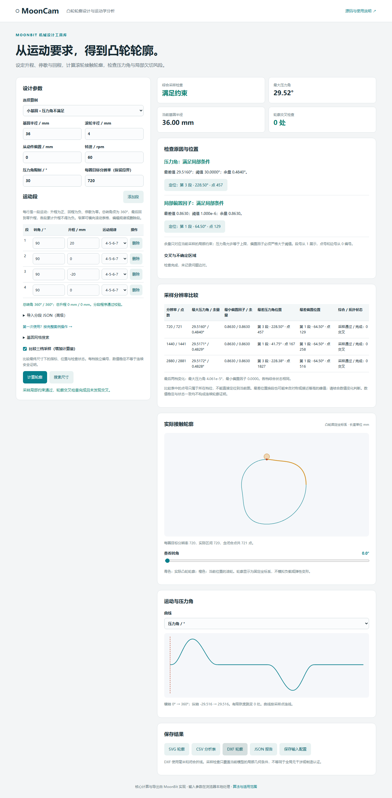

# 从超限方案到可导出轮廓

以 20 mm 升程的教学机构为例，完成一次“发现问题—定位—调整—复核—保存”。无需先写 JSON。核心模型为恒定正转速下的平面盘形凸轮与直动滚子从动件；下述结果是采样检查，不是制造认证。

## 实测对照：为什么调整基圆

本例模拟课程设计中的尺寸初选：要求从动件升起 20 mm、停歇、回落并再次停歇，每段占 90°，滚轮半径 4 mm，转速 60 rpm，压力角上限 30°。希望找出满足当前采样检查的基圆尺寸。它是可复算的教学案例，未声称来自已投产设备。

2026-10-26 使用 MoonCam 0.3.0 的 JS 引擎复算，保持运动程序与其余参数不变，仅调整基圆：

| 基圆半径 | 最大绝对压力角 | 相对 30° 上限的余量 | 最小局部偏置因子 | 折线交叉 | 综合结果 |
| --- | --- | --- | --- | --- | --- |
| 5 mm | 59.023577° | −29.023577° | 0.555556 | 检查完成，0 组 | 拒绝：压力角超限 |
| 35 mm | 30.032612° | −0.032612° | 0.859580 | 检查完成，0 组 | 拒绝：仍略超限 |
| 36 mm | 29.516044° | +0.483956° | 0.863002 | 检查完成，0 组 | 采样检查通过 |

以上均采用名义分辨率 720，实际 721 点（含闭合端点）。余量为“上限减最大绝对压力角”。偏置因子是无量纲局部几何指标，本例要求其大于 0.000001；它不是机械强度安全系数。

5 mm 方案虽未发现折线交叉，仍因压力角超限而被拒绝。增大基圆后，同样的升程分布在更大的机构尺度上，压力角降低；相应代价是机构尺寸增加。因此这里输出的是尺寸初选依据，不能据此决定强度、载荷或制造要求。35 mm 的反例也说明，不能把 30.032612° 四舍五入成 30° 后就宣称通过。

### 复核 36 mm 候选

| 名义分辨率 | 实际点数 | 最大绝对压力角 | 压力角余量 | 报告记录的最坏位置 | 综合结果 |
| --- | --- | --- | --- | --- | --- |
| 720 | 721 | 29.516044° | +0.483956° | 第 3 段，228.500° | 采样检查通过 |
| 1440 | 1441 | 29.517120° | +0.482880° | 第 1 段，41.750° | 采样检查通过 |
| 2880 | 2881 | 29.517161° | +0.482839° | 第 3 段，228.375° | 采样检查通过 |

三档的最小偏置因子均约 0.863002，交叉检查均完成且确定交叉数为 0。后两档最大压力角相差约 0.000041°，这是本次采样的观测值，不是误差上界或收敛证明。

最坏位置在第 1、3 段之间切换：本程序升程和回程对称，存在相同或近似相同的绝对压力角极值。网格和浮点计算可能改变报告记录的代表位置。因此应结合数值、运动段和对称性理解，不能仅凭段号变化认定结果不可靠。JSON 段号从 0 开始，表中按网页习惯从 1 开始。

### 用命令行复算

在仓库根目录执行：

```sh
npm run build
node bin/mooncam.mjs examples/pressure-limit.json --out artifacts/case-before
node bin/mooncam.mjs examples/size-search.json --out artifacts/case-search
node bin/mooncam.mjs examples/pressure-adjusted.json --out artifacts/case-after
```

第一条分析命令预期退出码为 2，表示成功分析并拒绝当前方案；应继续执行后面的命令。搜索在 5～100 mm、1 mm 间隔的有限网格上得到 36 mm 候选，粗分辨率 360、复核 720。调整后分析配置启用了三档采样比较，预期退出码为 0。可以检查各目录的 `report.json` 与 `input.json`，并查看导出的轮廓。

配套文件：[原始方案](../examples/pressure-limit.json)、[搜索配置](../examples/size-search.json)、[调整后方案与三档比较](../examples/pressure-adjusted.json)。这些输入保留了全部运动段和参数，便于重复检查。

本例证明的是：工具能发现采样超限、给出位置、找到有限网格候选并复核。它没有证明连续轮廓全局无干涉，也不包含 CAD 软件导入、实际加工或实物运行记录。

## 1. 填写运动要求

运行 `npm run build`、`npm run serve`，打开 http://127.0.0.1:4173/ 。选择“小基圆 · 压力角不满足”，等待表格载入四段：

| 段 | 转角 / ° | 升程 / mm | 规律 |
| --- | --- | --- | --- |
| 1 | 90 | 20 | 4-5-6-7 |
| 2 | 90 | 0 | 4-5-6-7 |
| 3 | 90 | -20 | 4-5-6-7 |
| 4 | 90 | 0 | 4-5-6-7 |

这表示升起、停歇、回落、停歇。表格下方应显示总转角 360°、总升程 0 mm、校验通过。每段可以独立选规律，添加或删除后要重新满足闭合条件。行内错误由 MoonBit 校验；若误删一段，重新选择算例可恢复。

保持基圆 5 mm、滚轮 4 mm、偏置 0 mm、转速 60 rpm、压力角限制 30°、分辨率 720。可下载完整输入：[压力角超限输入](../examples/pressure-limit.json)。高级导入框只接受其中的 `segments` 数组；“保存输入配置”导出的是完整配置。

## 2. 计算并找到问题位置

点击“计算轮廓”。综合检查应显示“需调整”；在“检查原因与位置”查看压力角超限及负余量。点击压力角的定位按钮，滑块、曲线游标、接触点和所属运动段同步选中。此算例首次最大压力角位于约 35.5°、第 1 段；对称位置可能有同等极值，不应把首次记录的位置解释成唯一极值。


压力角描述接触法线与从动件运动方向的夹角，此例限制为 30°。压力角检查通过仍要看偏置因子和轮廓交叉检查；正的压力角余量不能代替综合状态。

## 3. 搜索一个通过复核的尺寸

展开“基圆网格搜索”，设置最小半径 5 mm、最大半径 100 mm、网格区间数 95，即每隔 1 mm 检查一个候选。点击“搜索尺寸”。在本例条件下，结果给出 36 mm 候选，最大压力角约 29.52°，综合采样检查通过。搜索使用更细网格复核，结果会显示实际点数。

搜索结果只改变右侧报告，左侧基圆输入仍为 5 mm。后续单独分析前，请把左侧基圆明确改为 **36 mm**。参数变动时旧图表会标记为过期，必须重新计算。

可直接运行配套搜索输入：[尺寸搜索配置](../examples/size-search.json)（该文件粗分辨率为 360，复核为 720）。36 mm 是此有限网格的首个通过候选，不是连续参数空间的最小值。

## 4. 比较采样，核对余量

将基圆设为 36 mm、分辨率设为 720，勾选“比较三档采样”，点击“计算轮廓”。比较表应列出 720、1440、2880 三档，分别查看最大压力角、最小偏置因子、最差位置与综合状态。

若状态改变，或余量很小，应谨慎使用当前结论并进一步检查。最差段号变化也可能来自多个近似相等的极值，不能仅凭段号改变就判失败。数值变化小、三档状态一致，也不构成连续曲线的安全证明。不同档位的点号不能互相套用。



## 5. 导出并保留可复算输入

计算完成后，点击“保存输入配置”，同时保存“JSON 报告”“CSV 分析表”和所需的“SVG 轮廓”或“DXF 轮廓”。DXF 为毫米制闭合折线；SVG 用于查看，CSV 用于检查采样数据。导出对应上次提交计算时的参数，修改参数后须重新计算。

也可以用保存的输入复算：

```sh
node bin/mooncam.mjs mooncam-input.json --out artifacts/my-design
```

该目录包含输入、紧凑报告、CSV、SVG 和 DXF。拒绝轮廓同样允许导出以供诊断；能导出不代表检查通过。这里未提供商业 CAD 导入或实际加工验证。

后续理解字段与边界，可读[位置与诊断](位置诊断与采样比较.md)、[输入输出说明](输入输出说明.md)和[算法与适用范围](算法与适用范围.md)。
