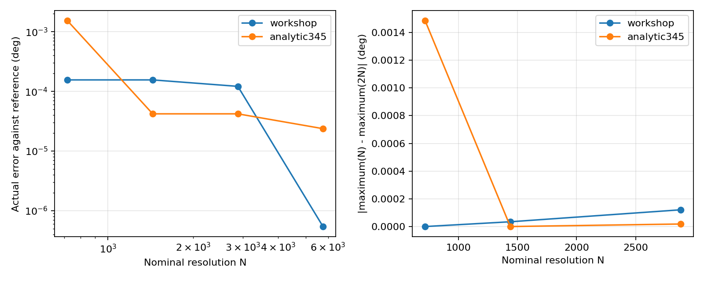

# 采样误差与加密实验

本实验直接调用 MoonBit 核心库，保持几何与运动程序不变，使用 720 / 1440 / 2880 / 5760 分辨率；没有提高网页或 JSON 的 4000 上限。源码见 examples/sampling，数据与计时见 [JSON](experiments/sampling-results.json)。



图左是相对连续极值参考的实际误差，图右是相邻档最大值的变化量。图中文字用标准英文字符避免环境字体缺失，数值单位为度。

## 常规教学算例

40 mm 基圆、4 mm 滚轮、零偏置，20 mm 升程，四段各 90°，4-5-6-7 规律。令 q=44+s，压力角为 atan(s′/q)，驻点满足 s″q−s′²=0。实验对精确有理系数多项式使用 Sturm 序列确认升程区间仅一个内部驻点，再用 40 位 Decimal 二分求值，并检查端点；回程由对称性得到。数值参考约 **27.609491080033°**，代表位置约 41.933590629° 和 228.066409371°。

| 分辨率 | 采样最大压力角 / ° | 相对参考亏欠 / ° |
| --- | --- | --- |
| 720 | 27.609335250922 | 0.000155829110 |
| 1440 | 27.609335250922 | 0.000155829110 |
| 2880 | 27.609369691940 | 0.000121388092 |
| 5760 | 27.609490539815 | 0.000000540218 |

720→1440 的变化量为零，但实际亏欠非零。最大值位置可能在对称的两个运动段之间切换；位置误差取到两个参考位置的最小距离，不直接比较报告角度之差。

## 闭式极值对照

采用 3-4-5 规律 f(u)=10u³−15u⁴+6u⁵，升程 h=20，段角 β=π/2，零偏置。选 u*=2/7，令 q0/h=f′(u*)²/f″(u*)−f(u*)=2568/16807。滚轮半径取 0.1 mm，基圆=q0−0.1 mm，都是合法正值。

驻点精确位于 u*=2/7；精确有理 Sturm 根计数确认 (0,1) 内无其他驻点。由 tan(α*)=f″(u*)/(βf′(u*)) 得 **α*=atan(8.4/π) ≈69.494247164193°**。这是非恒定运动的闭式压力角极值算例，不代表机构整体通过全部几何约束。

| 分辨率 | 相对闭式参考亏欠 / ° |
| --- | --- |
| 720 | 0.001526327364 |
| 1440 | 0.000042011067 |
| 2880 | 0.000042011067 |
| 5760 | 0.000023685144 |

数据记录 p=log2(e(N)/e(2N)) 的观测阶；误差没有明显下降时记 null。两例都存在网格对齐平台，不能宣称每加倍都有固定二阶收敛，偶然出现的大阶数也不代表算法的渐近阶。

## 复现与边界

```sh
npm run test:sampling
```

需要固定 MoonBit 工具链、Node.js 和 Python 标准库。CI 在两个平台运行并对照存档数值；热身后每档重复五次，记录平均分析耗时，不包含编译、进程启动、JSON 与文件导出，耗时不是跨机器验收阈值。重新绘图用 python tests/sampling_experiment.py --record，需要额外 matplotlib，仅用于开发。

本实验给出这两例的参考极值及实际误差，不给任意输入提供认证误差界。Decimal 运算不是有向舍入区间证明；Sturm 根计数是参考求解的完备性检查，不是生产分析器新增功能。公共 analyze 仍返回采样结论。
